<div align="center">




</div>

## 📌 About

The **Saya-e-Falah Admin Panel** is the management side of my Final Year Project. Foundation staff use it to review and manage every request that comes in from the [User Panel](https://github.com/Hamnakhan123/saya-e-falah_userpanel), all in one secure dashboard.

## ✨ Features

| Module | What admins can do |
|:--|:--|
| 🔐 **Secure Login** | Admin sign up / log in with Firebase Auth and private routes |
| 📊 **Dashboard** | Overview of all services at a glance |
| 🏠 **Adoption** | View and manage adoption applications |
| 🔎 **Missing Persons** | Review missing-person reports and update their status |
| 🚑 **Ambulance Drivers** | Register drivers and manage the driver list |
| 🎞️ **Smooth UI** | Animated, responsive interface with Framer Motion and MUI |

## 🛠️ Tech Stack

- **Frontend:** React 19, Vite, React Router 7
- **UI:** Material UI, Styled Components, Framer Motion, React Icons
- **Backend:** Firebase Authentication, Cloud Firestore, Firebase Storage (with security rules)

## 📂 Project Structure

```
src/
├── components/   # Dashboard, Adoption, MissingList, AmbulanceDriversList, Forms, Navbar
├── routes/       # PrivateRoute for protected pages
├── images/       # Assets
└── App.jsx       # Routes and layout
```

## 🚀 Getting Started

```bash
git clone https://github.com/Hamnakhan123/saya-e-falah_adminpanel.git
cd saya-e-falah_adminpanel
npm install
npm run dev
```

## 🔗 Related

- 👥 [Saya-e-Falah User Panel](https://github.com/Hamnakhan123/saya-e-falah_userpanel) · [Live](https://saya-e-falah.web.app/)

---

<div align="center">

**Built by [Hamna Zahid Khan](https://github.com/Hamnakhan123)** · Software Engineer · Lecturer · Web Developer · Event Organizer

[](https://hamnakhan123.github.io/Hamna_Portfolio/)
[](mailto:hamnazahidkhan@gmail.com)
[](https://github.com/Hamnakhan123)

</div>
